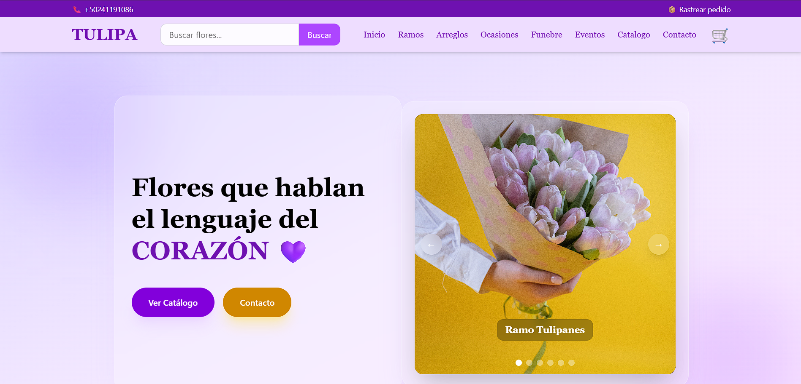
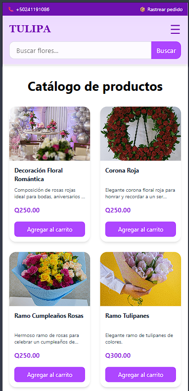
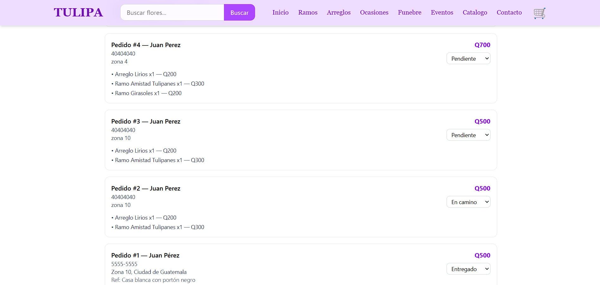
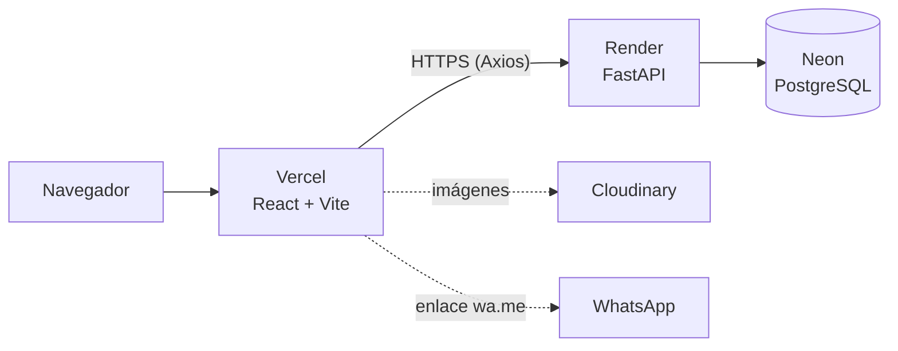

# 🌷 Tulipa — Florería en línea

Tienda en línea de flores con catálogo por categorías, carrito, pedidos por WhatsApp, seguimiento de pedidos y panel de administración. Es mi primer proyecto full-stack completo, desplegado en producción.

**🌐 Demo:** https://flores-app-ten.vercel.app
**📚 Documentación de la API:** https://flores-app-oyym.onrender.com/docs

> ⏳ El backend corre en el plan gratuito de Render, que "duerme" el servicio tras 15 minutos sin tráfico. Si la primera carga tarda hasta aproximadamente un minuto en mostrar los productos, es el servidor despertando; después responde normal.

## Capturas

| Inicio | Catálogo (móvil) | Panel de administración |
|---|---|---|
|  |  |  |

## Funcionalidades

**Cliente**
- Catálogo por categorías (Ramos, Arreglos, Fúnebres, Eventos, Cumpleaños, Aniversario y Amistad) y búsqueda por nombre, descripción o categoría.
- Detalle de producto con control de stock.
- Carrito que se conserva al recargar la página y nunca deja pedir más unidades de las disponibles.
- Checkout: registra el pedido en el backend y abre WhatsApp con el resumen listo para enviar.
- Seguimiento de pedido en `/rastreo`, con número de pedido y teléfono.
- Formulario de contacto, página 404 y diseño responsivo (revisado en pantallas de 360 y 375 px).

**Administrador**
- Inicio de sesión con contraseña y sesión con JWT de 12 horas.
- Panel de pedidos: ver cada pedido con sus productos y cambiar su estado (pendiente, confirmado, en camino, entregado, cancelado).
- Crear, editar y borrar productos protegido por autenticación (se usa desde `/docs`).

**Detalles de backend**
- El stock se descuenta en la misma transacción que crea el pedido, con bloqueo de fila (`SELECT ... FOR UPDATE`) para que dos clientes no compren la última unidad a la vez.
- El total del pedido lo calcula el servidor con los precios de la base de datos; nunca se confía en el precio que envía el navegador.
- Esquema de base de datos versionado con migraciones (Alembic).

## Tecnologías

| Capa | Tecnologías |
|---|---|
| Frontend | React 19, Vite, React Router 7, Tailwind CSS 4, Axios |
| Backend | FastAPI, SQLModel / SQLAlchemy, Alembic, Uvicorn |
| Autenticación | bcrypt (hash de contraseña) + JWT (PyJWT) |
| Base de datos | PostgreSQL 16 |
| Pruebas y calidad | Vitest, Testing Library, ESLint, GitHub Actions |
| Infraestructura | Vercel (frontend), Render (backend), Neon (PostgreSQL), Cloudinary (imágenes) |

## Arquitectura



## Estructura del proyecto

```
flores-app/
├── .github/workflows/ci.yml     # CI: lint + tests + build
├── docker-compose.yml           # PostgreSQL local
├── backend/
│   ├── main.py                  # App FastAPI, CORS, /health
│   ├── database.py              # Conexión a la base de datos
│   ├── models.py                # Producto, Pedido, DetallePedido
│   ├── auth.py                  # bcrypt + JWT
│   ├── seed.py                  # Carga productos de ejemplo
│   ├── routers/                 # productos, pedidos, admin
│   ├── schemas/                 # Modelos de entrada/salida
│   └── alembic/                 # Migraciones
└── frontend/
    ├── env.example              # Variables de entorno de ejemplo
    └── src/
        ├── api/                 # Cliente Axios y llamadas a la API
        ├── components/          # Componentes reutilizables (y home/)
        ├── pages/               # Páginas (y admin/)
        ├── context/             # Carrito y sesión de administrador
        ├── hooks/               # useProductos
        └── App.jsx              # Rutas
```

## Cómo correrlo en local

**Requisitos:** Node.js 20+, Python 3.12+ y Docker (solo para la base de datos).

```bash
git clone https://github.com/Bryan-lag/flores-app.git
cd flores-app
```

### 1. Base de datos

```bash
docker compose up -d
```

Levanta PostgreSQL 16 en el puerto `5433` (usuario `admin`, contraseña `123456`, base `miapp_db`).

### 2. Backend

```bash
cd backend
python -m venv .venv
# Windows (PowerShell): .venv\Scripts\Activate.ps1
# Mac / Linux:          source .venv/bin/activate
pip install -r requirements.txt
cp .env.example .env            # Windows: copy .env.example .env
```

Genera las credenciales del administrador y pégalas en `backend/.env`:

```bash
# Hash de la contraseña de admin  -> ADMIN_PASSWORD_HASH
python -c "import bcrypt; print(bcrypt.hashpw(b'TU-CONTRASENA', bcrypt.gensalt()).decode())"

# Clave para firmar los tokens    -> ADMIN_SECRET_KEY
python -c "import secrets; print(secrets.token_hex(32))"
```

Crea las tablas, carga los productos de ejemplo y arranca la API:

```bash
alembic upgrade head
python seed.py
uvicorn main:app --reload
```

La API queda en http://127.0.0.1:8000 y su documentación en http://127.0.0.1:8000/docs.

### 3. Frontend

```bash
cd frontend
npm install
cp env.example .env.local       # Windows: copy env.example .env.local
npm run dev
```

Abre http://localhost:5173. El panel de administración está en `/admin/login`, con la contraseña que usaste para generar el hash.

## Variables de entorno

**Backend (`backend/.env`)**

| Variable | Descripción |
|---|---|
| `DATABASE_URL` | Cadena de conexión a PostgreSQL |
| `CORS_ORIGINS` | Orígenes del frontend permitidos, separados por coma |
| `ADMIN_PASSWORD_HASH` | Hash bcrypt de la contraseña de administrador |
| `ADMIN_SECRET_KEY` | Clave secreta para firmar los tokens JWT |
| `SQL_ECHO` | (Opcional) `true` imprime cada consulta SQL en consola |

**Frontend (`frontend/.env.local`)**

| Variable | Descripción |
|---|---|
| `VITE_API_URL` | URL del backend (ej. `http://127.0.0.1:8000`) |
| `VITE_WHATSAPP_NUMBER` | Número de WhatsApp con código de país, solo dígitos (ej. `50255551234`) |

> Las variables `VITE_*` se leen al **compilar**: si las cambias en Vercel, hay que volver a desplegar.

## API

| Método | Ruta | Acceso | Descripción |
|---|---|---|---|
| GET | `/health` | Público | Estado del servicio y de la base de datos |
| GET | `/productos/` | Público | Lista productos (`?categoria=Ramos`) |
| GET | `/productos/{id}` | Público | Detalle de un producto |
| POST | `/productos/` | Admin | Crear producto |
| PUT | `/productos/{id}` | Admin | Editar producto |
| DELETE | `/productos/{id}` | Admin | Eliminar producto |
| POST | `/pedidos/` | Público | Crear pedido (descuenta stock) |
| GET | `/pedidos/rastreo` | Público | Consultar pedido por `pedido_id` + `telefono` |
| GET | `/pedidos/` | Admin | Listar todos los pedidos |
| PATCH | `/pedidos/{id}/estado` | Admin | Cambiar el estado de un pedido |
| POST | `/admin/login` | Público | Iniciar sesión (devuelve el token) |
| GET | `/admin/me` | Admin | Verificar que la sesión sigue vigente |

Para probar las rutas de administrador en `/docs`: haz `POST /admin/login`, copia el `access_token`, pulsa **Authorize** y pega **solo el token**.

## Pruebas y CI

```bash
cd frontend
npm test        # Vitest + Testing Library
npm run lint    # ESLint
```

El workflow de GitHub Actions (`.github/workflows/ci.yml`) corre lint, pruebas y build en cada push y pull request a `main`.

## Despliegue

El despliegue es automático: cada `git push` a `main` actualiza Vercel y Render, conectados directamente al repositorio.

- **Frontend (Vercel):** *Root Directory* `frontend`, con las variables `VITE_API_URL` y `VITE_WHATSAPP_NUMBER`.
- **Backend (Render):** *Root Directory* `backend`.
  - Build: `pip install -r requirements.txt && alembic upgrade head`
  - Start: `uvicorn main:app --host 0.0.0.0 --port $PORT`
  - Health check: `/health`
  - Variables: las del backend, con `CORS_ORIGINS` apuntando a la URL de Vercel.
- **Base de datos (Neon):** usé Neon porque la base de datos gratuita de Render se elimina a los 30 días.
- **Imágenes (Cloudinary):** las URLs se guardan en el campo `imagen_url` de cada producto.

## Decisiones de diseño

- **Pedidos por WhatsApp en vez de pasarela de pago.** Para una florería pequeña evita comisiones y encaja con cómo ya atiende a sus clientes. El pedido igual queda registrado en la base de datos.
- **Seguimiento con número de pedido + teléfono.** Así nadie puede ver pedidos ajenos probando números consecutivos. Los teléfonos se comparan solo por sus dígitos, para tolerar guiones y espacios, y si no coincide algo la respuesta es un 404 genérico.
- **Un solo administrador con contraseña única.** El hash se guarda en variables de entorno (nunca la contraseña) y la sesión es un JWT que expira en 12 horas. Es suficiente para un único dueño; lo ideal para varios usuarios sería un sistema de cuentas.
- **Migraciones con Alembic en vez de `create_all()`.** El esquema queda versionado y se aplica igual en local y en producción.
- **Encabezado `sticky` en lugar de `fixed`.** Al ocupar su espacio real, ninguna página necesita adivinar cuánto padding superior dejar.
- **Despliegue por integración con Git y CI solo para validar.** Vercel y Render ya despliegan al hacer push, así que GitHub Actions únicamente comprueba que el código esté sano.
- Diseño responsivo con navegación adaptada a móviles,
  tablets y escritorio.

## Limitaciones y próximos pasos

- No hay pagos en línea.
- Los productos se administran desde `/docs`, no hay interfaz visual para eso.
- Las pruebas automatizadas son mínimas: 8 pruebas en el frontend y ninguna automatizada en el backend.
- Las tarjetas de producto son cinco componentes casi idénticos; se pueden unificar en uno.
- El catálogo no tiene paginación.
- El plan gratuito de Render tiene arranque en frío (ver nota al inicio).

## Autor

**Bryan** · [GitHub](https://github.com/Bryan-lag) · [Linkedin][https://www.linkedin.com/in/bryan-argueta-9986a32b2] · [arguetab989@gmail.com]
